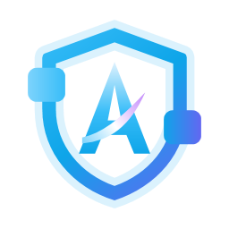

# Antigravity Customization Manager

<p align="center">
  
</p>

Master your Google Antigravity & AI Agent rules, skills, and token budgets across global and workspace scopes.

---

## Overview

**Antigravity Customization Manager** is a lightweight, zero-bloat control center for managing, authoring, and monitoring **Rules**, **Skills**, and **Token Budgets** used by AI coding agents across the Google Antigravity ecosystem and compatible environments.

It provides visual token budget meters to prevent silent rule demotion, file size guardrails, skill shadowing detection, a scaffolding wizard, and 1-click cross-agent sync to other major AI coding assistants.

### Compatibility
- **Editors**: Visual Studio Code, Google Antigravity Standalone IDE, Cursor, and other VS Code-compatible editors.
- **Antigravity Extension**: Official Google Antigravity extension `1.3.0+`, AGY backend `1.2.2+`.
- **Platforms**: Windows, macOS, Linux.

---

## Features

### Rules Governance & Lifecycle
- **Multi-Scope Rule Discovery**:
  - **Global Rules**: Discovered from `~/.gemini/config/rules/*.md` (system-wide machine rules).
  - **Workspace Root Rules**: Discovered from `GEMINI.md` and `AGENTS.md` at repository roots.
  - **Workspace Modular Rules**: Discovered from `.agents/rules/*.md` (or `.agent/rules/`).
- **Precision Antigravity Budget Guardrails**:
  - **24 KB / 24,000 Byte Cap**: Visual warning before rule files get truncated on line boundaries.
  - **20,000 Token Aggregate Budget**: Live meter monitoring rule consumption to prevent rules from being demoted from inline text to path pointers.
- **Rule Templates**: Scaffold governance policies with built-in templates (Developer SOP & Release Gates, Architecture Boundaries, Git Index Protection, Anti-AI Slop Guidelines).
- **Toggle State**: Enable or disable rules temporarily without deleting files.

### Skills Engine & Progressive Disclosure
- **Multi-Tier Skill Discovery**:
  - **Workspace Skills**: `.agents/skills/<name>/SKILL.md` (highest precedence).
  - **Global Plugin Skills**: `~/.gemini/config/plugins/<plugin>/skills/`.
  - **Built-in Skills**: `~/.gemini/antigravity/builtin/skills/`.
- **Precedence & Shadowing Detector**: Visual indicators when a workspace skill overrides or shadows a global/built-in skill.
- **Skill Scaffolding Wizard**: Step-by-step generator for standard-compliant skills with verified YAML frontmatter (`name`, `description`) and directory structures (`scripts/`, `references/`, `examples/`).
- **Fork to Workspace**: Clone any built-in system skill or plugin skill directly into `.agents/skills/` of the current workspace with a single click.

### Multi-Agent Cross-Bridge
- Write rules once and sync them to other popular AI coding assistants:
  - **Universal Standard**: `AGENTS.md` (Linux Foundation standard for Antigravity, OpenAI Codex, and multi-agent workflows)
  - **OpenAI Codex**: `CODEX.md`
  - **Cursor**: `.cursorrules` / `.cursor/rules/*.mdc`
  - **Claude Code**: `CLAUDE.md`
  - **GitHub Copilot**: `.github/copilot-instructions.md`

### Zero-Bloat Architecture & Native Experience
- **Performance**: Vanilla TypeScript and Webview API. Zero third-party web frameworks, zero telemetry, instant boot.
- **Bilingual Support**: Instant toggle between **English** and **Bahasa Indonesia**.
- **Native Theme Support**: Automatically matches VS Code Dark Modern, Light Modern, High Contrast, and OS system themes.
- **Status Bar Integration**: Real-time summary indicator of active rules and budget health with warning badges.

---

## Commands

All commands are accessible from the Command Palette (`Ctrl+Shift+P` / `Cmd+Shift+P`):

| Command | Description |
| :--- | :--- |
| `Antigravity Customization Manager: Focus Customization Manager View` | Opens and focuses the sidebar dashboard |
| `Antigravity Customization Manager: Refresh Rules & Skills` | Refresh rules, skills, and token budget calculations |
| `Antigravity Customization Manager: Create New Rule...` | Launch rule creation dialog with built-in templates |
| `Antigravity Customization Manager: Create New Skill...` | Launch skill scaffolding wizard |
| `Antigravity Customization Manager: Sync / Export Rules to Multi-Agent...` | Export rules to AGENTS.md, CODEX.md, Cursor, Claude, or Copilot |
| `Antigravity Customization Manager: Open Settings` | Open webview customization settings modal |

---

## Configuration

Customize settings via your editor's `settings.json`:

```json
{
  // Custom override path to Antigravity directory (~/.gemini). Auto-detected if blank.
  "boygr.antigravityCustomizationManager.customAntigravityPath": "",

  // Aggregate token budget for always-on rules before pointer demotion occurs
  "boygr.antigravityCustomizationManager.defaultRulesBudget": 20000,

  // Per-rule file size limit in bytes before hard boundary truncation occurs
  "boygr.antigravityCustomizationManager.ruleFileSizeLimitBytes": 24000,

  // Display active rules and skills summary indicator in the status bar
  "boygr.antigravityCustomizationManager.showStatusBarItem": true,

  // UI display language: "auto", "en", or "id"
  "boygr.antigravityCustomizationManager.defaultLanguage": "auto",

  // Enable 1-click cross-agent rule export capabilities
  "boygr.antigravityCustomizationManager.enableMultiAgentSync": true
}
```

---

## Installation

### From VSIX Package

1. Download the latest `antigravity-customization-manager-0.1.0.vsix` from [GitHub Releases](https://github.com/BoyGR/antigravity-customization-manager/releases).
2. Install via editor:
   - **GUI**: In the Extensions view (`Ctrl+Shift+X`), click `...` at the top right and choose **Install from VSIX...**.
   - **CLI**:
     ```powershell
     # Visual Studio Code
     code --install-extension antigravity-customization-manager-0.1.0.vsix

     # Google Antigravity IDE
     antigravity --install-extension antigravity-customization-manager-0.1.0.vsix

     # Cursor
     cursor --install-extension antigravity-customization-manager-0.1.0.vsix
     ```

---

## Development

```powershell
# Install dependencies
npm install

# Compile TypeScript and bundle with esbuild
npm run compile

# Package production VSIX
npm run package:vsix
```

---

## License

- **Author**: [Boy Gilang Ramadhan](https://boygr.com)
- **License**: [MIT License](LICENSE)
- **Disclaimer**: Not affiliated with or endorsed by Google LLC. Google Antigravity is a trademark of Google LLC.
